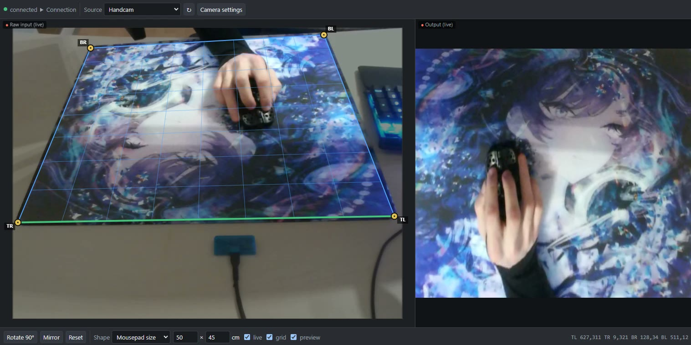

# Handcam Pin

An OBS Studio video filter that perspective-corrects an angled webcam, such as a
"handcam" filming your mouse from the side. You drag four corners onto your
mousepad in a small browser editor, and the filter warps that area so it fills the
output, straight-on.



- Native plugin in plain C. It depends only on libobs, with no Qt and no
  obs-shaderfilter.
- Builds for Windows, Linux and macOS (universal), for OBS 31 and newer.
- The editor works in any browser and as an OBS dock. It shows a live preview of
  the output while you drag.

> **Status:** tested on Windows 11 with OBS 32.2, using both the Direct3D 11 and
> OpenGL renderers. The Linux and macOS builds come from CI and haven't been tried
> on real machines yet. If you run one, please
> [open an issue](../../issues) to say whether it works.

## Install

Download the zip for your OS from the [Releases](../../releases) page.

### Windows

Right-click the zip → *Extract All…* and type `C:\ProgramData\obs-studio\plugins` as
the destination. Windows creates any missing folders, and no admin rights are needed.
(`ProgramData` is hidden in Explorer, but typing the path works.) You should end up with:

```
C:\ProgramData\obs-studio\plugins\handcam-pin\bin\64bit\handcam-pin.dll
C:\ProgramData\obs-studio\plugins\handcam-pin\data\
```

<details><summary>Portable OBS, or prefer the OBS install folder?</summary>

Portable OBS may only look in its own folder. Copy the files there instead (this
needs admin rights for `C:\Program Files`):

```
<OBS folder>\obs-plugins\64bit\handcam-pin.dll        ← from handcam-pin\bin\64bit\
<OBS folder>\data\obs-plugins\handcam-pin\            ← contents of handcam-pin\data\
```
</details>

### Linux

Extract the zip into `~/.config/obs-studio/plugins/`:

```
~/.config/obs-studio/plugins/handcam-pin/bin/64bit/handcam-pin.so
~/.config/obs-studio/plugins/handcam-pin/data/
```

For the Flatpak version of OBS, use `~/.var/app/com.obsproject.Studio/config/obs-studio/plugins/` instead.

### macOS

Copy `handcam-pin.plugin` into `~/Library/Application Support/obs-studio/plugins/`.
The bundle is ad-hoc signed, not notarized. If macOS refuses to load it, run:

```bash
xattr -dr com.apple.quarantine ~/Library/Application\ Support/obs-studio/plugins/handcam-pin.plugin
```

Restart OBS after installing. In the log you should see `[handcam-pin] loaded version …`.

**Updating:** close OBS, delete the old `handcam-pin` folder (`handcam-pin.plugin`
on macOS), extract the new one in its place, and start OBS. Your corners and shape
are stored in your OBS scene collection, so they're kept. **Uninstalling:** delete
that folder.

## Usage

1. **Add the filter.** Right-click your webcam source → *Filters* → **+** → *Handcam Pin*.
   (The editor can also add it for you, see step 3.)
2. **Turn on obs-websocket.** Tick *Tools → WebSocket Server Settings → Enable WebSocket
   server*. That's all: you don't need to copy the password, the plugin passes it
   to the editor.
3. **Open the editor.** Click *Open editor* at the top of the filter's properties. It
   opens in your browser and connects by itself. To keep it inside OBS instead, copy
   the *Dock URL* shown below the button into *Docks → Custom Browser Docks*.
4. **Pick the source** from the *Source* dropdown. Sources that already have the
   filter are listed first. For any other video source, press **Add filter**.
5. **Grab a frame.** The editor takes one still, unfiltered frame from the camera
   (it switches the filter off for a moment) and loads the saved corners.
6. **Drag the corners** onto the four corners of your mousepad. The right-hand
   pane shows the real OBS output live.
7. **Set the shape.** Enter your mousepad's real size (e.g. 49 × 42 cm) so the
   result isn't stretched, or pick *Square* or *Same as camera*.

Tip: the output's pixel size changes when you change the shape, which resizes the
source in your scene. To keep its box fixed, right-click the source in the scene →
*Transform → Edit Transform* → *Bounding Box Type: Scale to inner bounds*.

### Editor controls

| Action | How |
| --- | --- |
| Move a corner | Drag its handle (a magnifier appears) |
| Move the whole quad | Drag inside it |
| Nudge | Arrow keys move the selected corner or the whole quad by 1 px. Hold *Shift* for 10 px, *Alt* for ¼ px |
| Select a corner | Click it, or press *Tab* while the canvas has focus. *Esc* deselects |
| Rotate 90° | Cycles the corners (TL←BL←BR←TR), turning the output a quarter turn |
| Mirror | Swaps left and right corners |
| Reset | Back to the default 10 % inset |
| Shape | *Mousepad size* (width × height), *Square* or *Same as camera* |
| Camera settings | Opens the source's OBS properties (focus, exposure etc. are under *Configure Video* on Windows) |
| grid / preview | Toggle the perspective grid and the live output pane |

The thick green edge is the top of the output. Changes are sent to OBS while you
drag, and changes made in OBS (sliders, the buttons in the filter dialog) appear in
the editor within about half a second.

**How the editor gets the connection details.** On every start, and when you press
*Open editor*, the plugin writes a copy of `editor.html` into OBS's
`plugin_config/handcam-pin/` folder with obs-websocket's port and password filled
in. *Open editor* and the *Dock URL* use that copy, so a password change is picked
up after the next OBS start. If the editor can't connect, it tells you to enable the
WebSocket server and retries until you do. To connect to OBS on another computer,
open the editor's *Connection* section and enter its address and password.

You can pass settings in the URL, for example
`editor.html?host=127.0.0.1&port=4455&source=Webcam&filter=Handcam%20Pin`.
Connection settings (including the password, unless you untick *remember*) are
kept in the browser's local storage.

## Filter settings

| Setting | Meaning |
| --- | --- |
| `tl_x` … `bl_y` | The four corners in normalized source coordinates (0–1, origin top-left). Default: 10 % inset. |
| `shape` | `pad` (default): use the mousepad size below. `square`: 1:1. `source`: same ratio as the camera. |
| `pad_width`, `pad_height` | Real mousepad size, labelled cm. Only the ratio matters, so mm or inches work too. Default: 45 × 40. |

You never set pixels. The output is the largest size with the chosen ratio that
fits inside the camera frame, so no pixels are invented. A 1920×1080 camera gives
1920×853 for a 90 × 40 cm pad and 1080×1080 for *Square*. The size only changes
when the shape or the camera resolution changes, never while you drag corners.

The filter dialog also has Rotate 90°, Mirror and Reset buttons and sliders for fine
tweaks. Non-convex or degenerate quads are ignored, and the last valid warp stays
active.

## Building from source

Only the libobs headers are needed, with no OBS install, SDK or CMake. They are not
committed: on the first build, `build.sh` downloads them for the OBS release pinned
in [`OBS_VERSION`](OBS_VERSION) (currently 31.1.2) into the gitignored `vendor/`
folder, so the first build needs `git` and internet. To build against another OBS
release, change `OBS_VERSION`; the next build fetches the matching headers.

```bash
./build.sh            # build into dist/stage/
./build.sh package    # build + zip
./build.sh install    # build + copy into your per-user OBS plugin folder
```

| OS | Needs | Notes |
| --- | --- | --- |
| Linux | `cc` (gcc/clang) | libobs symbols are left undefined and resolved when OBS loads the plugin |
| macOS | Xcode command line tools | Universal binary, `-undefined dynamic_lookup`, ad-hoc signed |
| Windows | [Zig](https://ziglang.org) 0.15+, Git Bash | `zig dlltool` makes `obs.lib` from `windows/obs.def`. If you call a new libobs function, add it there |

CI (`.github/workflows/build.yml`) builds on native Linux, Windows and macOS runners.
Pushing a `v*` tag publishes a GitHub release with the three zips.

## Notes

- **Why "Open editor" isn't a link button.** OBS's URL buttons only open
  `http(s)` links, so the button asks the OS to open the bundled HTML file instead.
- **The raw frame is a still.** A live raw view would mean switching the filter off
  constantly, which would flicker your stream. Press *Grab frame* to refresh it.
  The output pane is live.

## License

GPL-2.0-or-later (it links against libobs). See [LICENSE](LICENSE).
